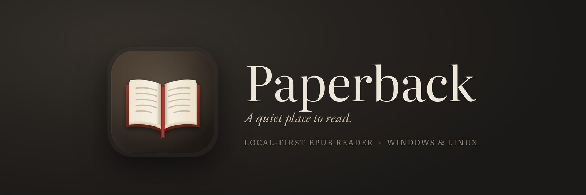
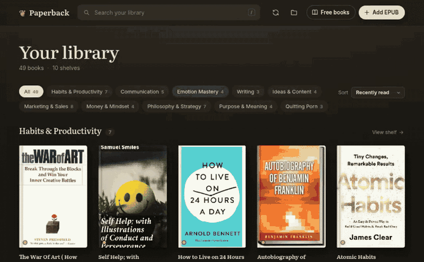
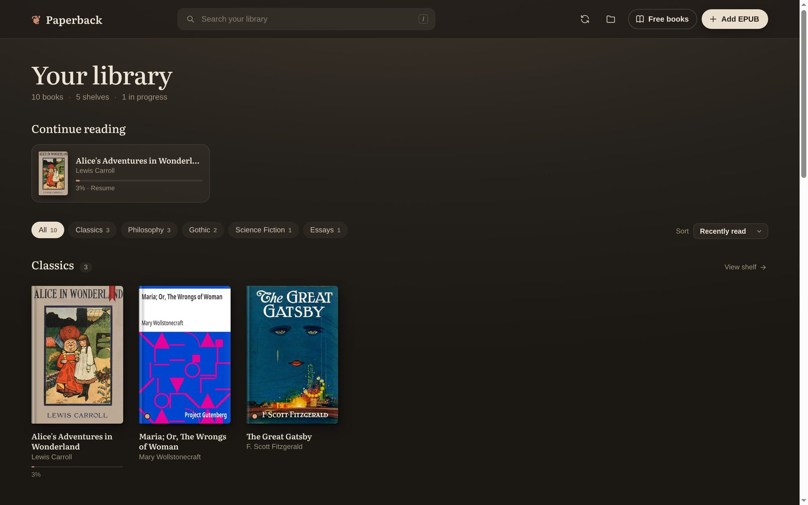
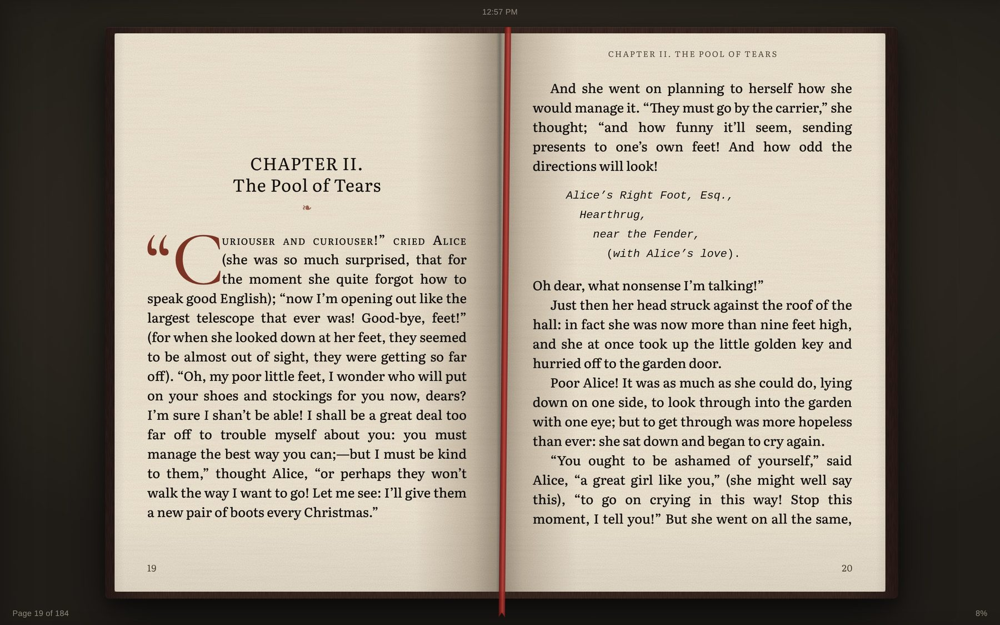
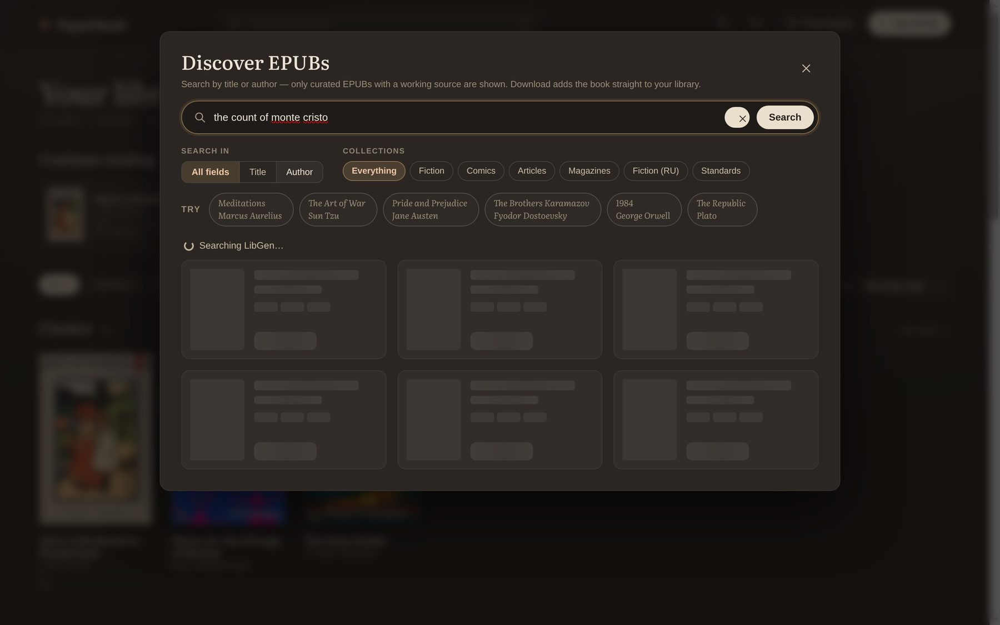
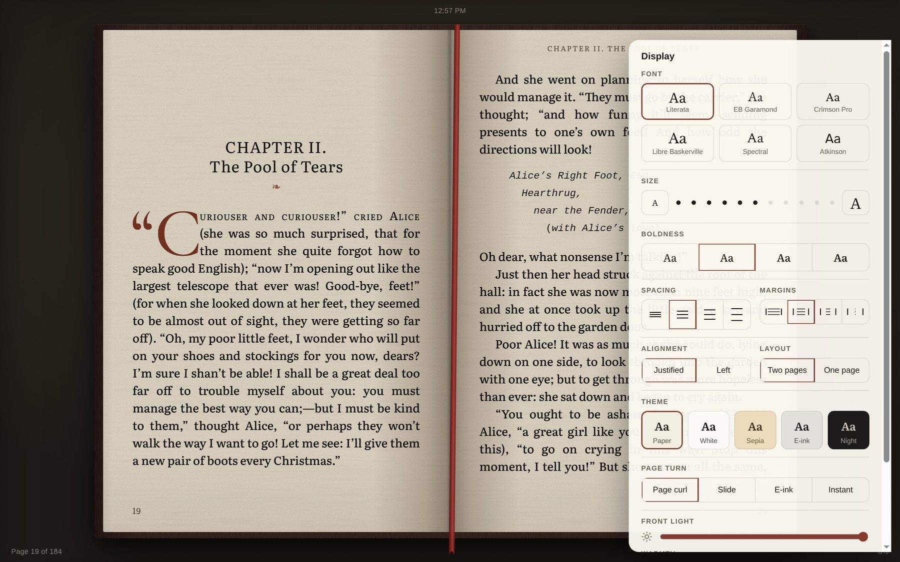

<p align="center">
  
</p>

<h1 align="center">Paperback</h1>

<p align="center">
  <b>A local-first EPUB reader that feels like a printed book — with free-book search built in.</b>
</p>

<p align="center">
  <a href="LICENSE"></a>
  
  
  <a href="https://github.com/dev-adalz/paperback-reader/releases"></a>
  <a href="https://github.com/dev-adalz/paperback-reader/actions/workflows/build.yml"></a>
</p>

<p align="center">
  <a href="#install">Install</a> ·
  <a href="#screenshots">Screenshots</a> ·
  <a href="#features">Features</a> ·
  <a href="#run-from-source">Run from source</a> ·
  <a href="#build-installers">Build installers</a> ·
  <a href="CONTRIBUTING.md">Contributing</a>
</p>

---

Paperback is a desktop EPUB reader for Windows and Linux (plus a browser dev mode). It keeps
your books, reading positions, highlights and notes on your own device, and fills your shelves
in two ways: **import your own EPUB files**, or **search LibGen inside the app and download an
EPUB straight into your library**. No account, no cloud, no tracking.

> **Search LibGen → Download EPUB → lands in your library → read offline forever.**

<p align="center">
  
</p>

<p align="center"><sub>Search LibGen, download an EPUB straight into your library, and start reading.</sub></p>

## Screenshots

**Your library** — shelves group themselves, progress is remembered, and every book cover is
pulled from the EPUB itself.



**Reading** — two-page spreads with print typography: drop caps, oldstyle numerals,
hyphenation, running heads, folios and a satin ribbon marker.



**Free books** — search LibGen without opening a browser. Results are filtered to EPUBs with a
working source, ranked by how well they match, and download straight into your library.



**Make it yours** — six bundled fonts, eleven sizes, five themes (including e-ink and night),
margins, spacing, alignment and one- or two-page layout.



---

## Install

### Windows

1. Download `Paperback-<version>-Setup.exe` from
   [Releases](https://github.com/dev-adalz/paperback-reader/releases).
2. Run it — per-user install (no admin needed), pick your folder, desktop and Start-menu
   shortcuts are created.
3. The installer is **unsigned**, so SmartScreen may ask: *More info → Run anyway*.

### Linux

```bash
chmod +x Paperback-<version>-x86_64.AppImage
./Paperback-<version>-x86_64.AppImage
```

Optional desktop integration from a source checkout:

```bash
./scripts/install-linux.sh           # add Paperback to your app menu
./scripts/install-linux.sh --remove  # remove it (your books are untouched)
```

Installers include the built-in free-books search engine, so everything works right after
installing — no Python or other dependencies to set up.

Both installers are built by [GitHub Actions](.github/workflows/build.yml) on every `v*` tag.

---

## Use it

1. **First run** — the empty library offers *Search free books* and two public-domain classics.
   Click **Search free books**, type a title or author, press Enter.
2. Pick an **EPUB** result and press **Download**. The button shows every stage —
   `Resolving… → 0% … 100% → Importing… → ✓ In library` — and the book opens from your shelf.
3. **Or import your own:** drag `.epub` files onto the window, or use **Add EPUB**.
4. Reading progress, highlights, notes and bookmarks are remembered per book, locally.

### Where are my books?

- Installed builds: `Documents/Paperback Library/` (`books/` + `metadata.json`).
- Source builds: the project's `library/` folder.
- Change it: **Shift-click the folder icon** in the library header, or click it when no folder
  is set. Copy EPUBs into `<your folder>/books/` from anywhere — Paperback notices.

### Keyboard shortcuts

`←/→`, `Space`, `PgUp/PgDn` turn pages · `T` contents · `/` search · `N` notebook · `A`
display settings · `B` bookmark · `F` full screen · `+/-` text size · `Esc` close.

---

## Features

### Search and download free books (desktop)

- **Built-in LibGen search** in the *Free books* panel — search everything, or restrict to
  title/author; filter by collection (fiction, comics, articles, magazines, standards).
- **EPUB-only, curated results.** PDFs and rows with no working source are filtered out
  before they reach the UI; duplicates are removed; results are **ranked by how well the
  title/author match what you typed**, so the actual book comes first.
- **One-click download, straight into your library** — no downloads-folder detour, no manual
  importing. The new book appears on the shelf and opens immediately.
- **Live progress** on the button: resolving link → connecting → % downloaded → validating →
  importing → *✓ In library*.
- **A careful downloader, not a browser hack:**
  - the direct link is resolved by `libgen-api-enhanced`, so session-bound keys stay in Python
    and never touch the page;
  - only an **allowlist of LibGen / book-CDN hosts** can be contacted, re-checked on **every
    redirect hop**;
  - a download must be an **EPUB** (ZIP + `mimetype` + end-of-central-directory checks), capped
    at 200 MB, with timeouts, cancellation, and temp-file cleanup;
  - if a mirror is stale or the CDN doesn't carry the file, the app **retries the next
    approved mirror** automatically.
- One download at a time, cancellable, with a copy-MD5 chip for power users.

### Bring your own books

- **Drag and drop** one or many `.epub` files anywhere on the window.
- **Add EPUB** file picker (multi-select).
- **A real library folder** — choose any folder (default: `Documents/Paperback Library` on
  installed builds). Paperback **watches `books/`** and indexes files you copy in from your
  file manager, phone sync, Calibre, etc. Replace a file and the catalogue updates; delete one
  and it leaves the shelf.
- **Duplicate-safe** by content hash (SHA-256): importing the same book twice doesn't double
  it. Broken files are skipped and remembered so they don't slow every scan.
- **Open the folder** in your file manager with one click; change it with Shift-click.
- Two **public-domain sample classics** are included for a zero-setup first run.

### Reading experience

- **Two-page spreads** on wide screens: hardcover board, spine-gutter shadow, page-curvature
  lighting, satin ribbon marker, and stacked page edges whose thickness shows how much you've
  read versus what's left.
- **Paper**: warm fibre/grain texture; text and illustrations are multiplied onto the paper so
  ink and engravings look printed, not pasted.
- **Print typography**: justified text with hyphenation, oldstyle numerals, ligatures,
  indented paragraphs without gaps, baseline-snapped page heights, widows/orphans control,
  chapters that start on a new page with a sunk opening, drop cap and small-caps lead-in, a ❧
  ornament under chapter titles, ⁂ for scene breaks, running heads and folios.
- **Page turns**: 3D page curl (drag it with a finger on touch screens), slide, e-ink
  (black/white refresh flash with ghosting), or instant.
- **Display sheet**: six bundled fonts (SIL OFL, so it typesets offline), eleven sizes, line
  spacing, margins, alignment, one or two pages, five themes (Paper, White, Sepia, E-ink,
  Night), and front-light brightness and warmth.
- **Kindle-style conveniences**: tap zones, real print page numbers when the EPUB has them, a
  cycling status line (page / location / time left in chapter / time left in book), adaptive
  reading speed, progress scrubber with "Back to page N", table of contents with page numbers,
  full-text search, highlights in four colours, notes, a notebook, dictionary lookup, footnote
  pop-ups, bookmarks, and reading positions that survive font/size/screen changes.

### Shelves that sort themselves

- **Offline auto-categorisation**: another book by the same author, a small learned tf–idf
  model over title/publisher subjects/description, and a few seed keywords. No AI service, no
  network — it only guesses when one shelf clearly wins; otherwise the book stays
  Uncategorized.
- Custom shelves, per-shelf views, reading progress, and "in progress" / "finished" counts.
- Library search, sort modes, and a "continue reading" row.

### Local-first, by architecture

- Books and metadata live in **your** library folder; positions, highlights and notes live in
  the app's local storage. Nothing is uploaded.
- The renderer **cannot** reach the network or filesystem directly: the Electron window is
  sandboxed with context isolation, and a narrow preload bridge exposes only library and
  download calls.
- The renderer never sees or supplies URLs — it speaks `md5` + title, and the main process
  resolves, validates and fetches. IPC is origin-checked.
- A single-instance lock prevents two copies of the app from corrupting the same library.
- Library catalogue writes are serialised and atomic (temp file → rename).

### Platform support

- **Windows** — NSIS installer (x64): per-user install, choose your install folder, desktop
  and Start-menu shortcuts.
- **Linux** — AppImage (x64): download, `chmod +x`, run. A from-source desktop-entry installer
  (`scripts/install-linux.sh`) is included for launcher integration.
- **Browser dev mode** — `npm start` serves the reader at `http://localhost:3000` with
  IndexedDB storage (reading and importing; downloads are desktop-only).

---

## Run from source

Requirements: **Node.js 20+** and **npm**. Python 3.9+ only for LibGen search/downloads.

```bash
git clone https://github.com/dev-adalz/paperback-reader.git paperback
cd paperback
npm install

npm run app     # desktop app (Electron)
npm start       # browser mode at http://localhost:3000
npm run dev     # browser mode with auto-restart
```

On some Linux distributions Electron's sandbox helper needs a one-time fix:

```bash
sudo chown root:root node_modules/electron/dist/chrome-sandbox
sudo chmod 4755 node_modules/electron/dist/chrome-sandbox
```

Linux users who install via `scripts/install-linux.sh` get a `--no-sandbox` fallback hint
instead.

### Python for the Free books panel (source builds only)

Installed builds bundle the search engine, but a source checkout does not — LibGen search
and download use [`libgen-api-enhanced`](https://github.com/onurhanak/libgen-api-enhanced)
through a small Python helper (`engine/libgen.py`). Everything else works without Python.
To set it up:

```bash
# Linux / macOS
python3 -m venv .venv
.venv/bin/pip install -r engine/requirements.txt

# Windows (PowerShell)
py -3 -m venv .venv
.venv\Scripts\pip install -r engine\requirements.txt
```

Paperback picks `.venv` up automatically. A system Python with `libgen-api-enhanced`
installed works too, as does any interpreter you point at with `PAPERBACK_PYTHON`. If no
Python is found, the *Free books* panel says so instead of failing silently.

---

## Build installers

```bash
npm run dist:linux   # → dist/Paperback-<version>-x86_64.AppImage
npm run dist:win     # → dist/Paperback-<version>-Setup.exe   (run on Windows)
npm run dist:dir     # unpacked app for quick testing
```

- Every `dist` script first freezes `engine/libgen.py` into a self-contained binary
  (`npm run freeze`, PyInstaller), so installers ship LibGen search without requiring Python.
  Cross-building the Windows installer on Linux skips that step (PyInstaller cannot
  cross-compile) — build on Windows, or let CI do it, to bundle the engine there.
- Windows installers are best built **on Windows**; cross-building from Linux works when a
  **32-bit Wine prefix** is available
  (`WINEPREFIX=~/.wine32 WINEARCH=win32 npx electron-builder --win nsis`).
- The GitHub Actions workflow (`.github/workflows/build.yml`) builds both artifacts on every
  `v*` tag and attaches them to a release, so you don't need a Windows machine to ship.
- The app is packaged with `asar` disabled so the local API server and bundled search engine
  can be read and spawned from the install directory.

---

## Project layout

```
index.html            the library + reader shell
css/app.css           library & UI · css/book.css print typography · css/fonts.css bundled fonts
js/main.js            library UI, import pipeline, shelf
js/reader.js          pagination (CSS columns), navigation, highlights, notes, drawers
js/epub.js            EPUB parser + CSS sanitiser (scopes publisher CSS to a whitelist)
js/discover.js        Free books panel: search, curation UI, download buttons
js/library.js         one library API: desktop folder backend / browser IndexedDB backend
js/store.js           IndexedDB: positions, highlights, notes, progress
js/categorize.js      offline auto-categorisation (pure functions)
js/turn.js            page-turn animations
electron/main.js      window, paperback:// protocol, IPC, library folder, download orchestration
electron/library.js   on-disk catalogue, atomic writes, watcher
electron/download.js  streaming downloader, redirect host revalidation, EPUB validation
electron/preload.cjs  the narrow (and only) bridge between page and app
engine/libgen.py      search + direct-link resolution via libgen-api-enhanced
engine/sources.js     result curation/ranking, allowed hosts, Python launcher, source adapter
engine/bin/           frozen engine shipped in installed builds (build artifact, not committed)
server.js             the tiny static + /api/search server used by both modes
samples/              two public-domain EPUBs for the first-run experience
scripts/install-linux.sh   desktop-entry installer
scripts/freeze-engine.mjs PyInstaller freeze of the engine for installed builds
docs/screenshots/     the images in this README
build/                app icons for the installer/AppImage
```

---

## Legal and privacy

- Paperback **does not host or distribute any books**. It is a reader, an importer, and a
  search client for LibGen, a third-party site.
- LibGen indexes both public-domain works and copyrighted material. Downloading copyrighted
  material without permission may be illegal where you live. **You are responsible for what
  you search for and download.** Prefer public-domain and freely licensed works.
- Search queries leave your machine **only when you use the Free books panel** — they go to
  LibGen. Reading, importing and your library never touch the network.
- No analytics, no accounts, no telemetry.

---

## Contributing

Issues and pull requests are welcome — see [CONTRIBUTING.md](CONTRIBUTING.md). Good first
issues: new themes, better EPUB edge cases, accessibility, translations, and tests for the
categoriser and the downloader.

## Licence

Apache License 2.0 — see [LICENSE](LICENSE). Bundled fonts are under the SIL Open Font License;
the two sample books are public domain (Project Gutenberg). LibGen integration relies on
[libgen-api-enhanced](https://github.com/onurhanak/libgen-api-enhanced) (MIT). Full third-party
attribution is in [NOTICE](NOTICE).
